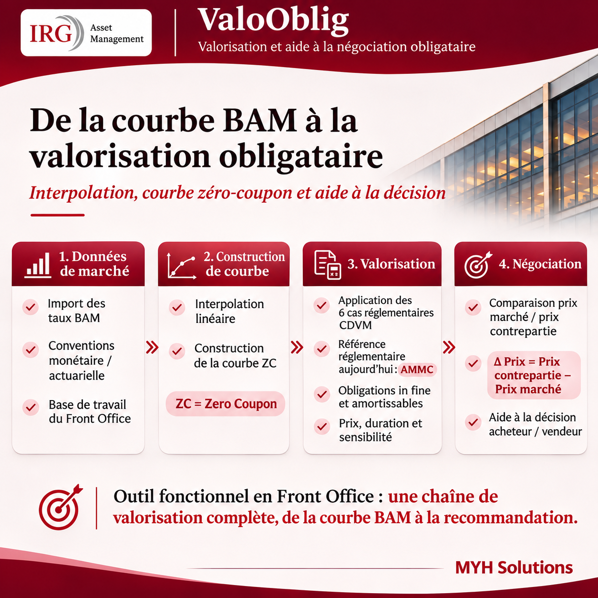
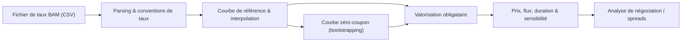
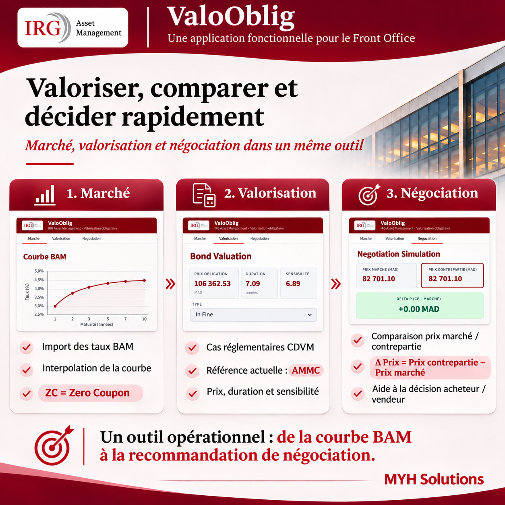

# ValoOblig — Valorisation obligataire en Python

**Projet de stage de fin d'études | Yassine Hammouti**

ValoOblig est une application développée avec **Python et Streamlit** dans le cadre d'un stage chez **IRG Asset Management**, à Casablanca. Elle permet d'explorer les taux de référence du marché marocain et les méthodes de valorisation d'obligations.

> **Problématique :** comment passer des données de taux BAM à une valorisation obligataire structurée, avec une lecture des flux, des courbes et du risque de taux ?

## Ce que contient le projet

| Domaine | Fonctionnalités implémentées dans le code |
|---|---|
| Données de marché | Import CSV des taux de référence des bons du Trésor (BAM) |
| Courbes | Interpolation des taux, transformation monétaire/actuarielle et construction d'une courbe zéro-coupon par bootstrapping |
| Obligations | Valorisation d'obligations In Fine et de titres à flux amortissables |
| Risque | Duration, sensibilité et analyse des flux actualisés |
| Négociation | Comparaison de prix et analyse des écarts de rendement |
| Interface | Pages Streamlit : marché, valorisation, négociation |

## Architecture fonctionnelle

## Choix techniques

**Python** pour les traitements financiers et la manipulation des données ; **pandas** pour les structures tabulaires ; **Streamlit** pour une interface accessible sans coder ; **Plotly** pour la visualisation des courbes.

## Statut du projet

Ce dépôt est une **présentation publique**, pas le code source de production. Les modèles et conventions financières doivent être vérifiés par des tests de référence indépendants avant tout usage opérationnel. Aucune performance de pricing ou conformité réglementaire n'est revendiquée.

Le projet sera présenté progressivement avec des exemples pédagogiques, sans données internes de l'entreprise.

## Application et simulation de négociation

## Accès au code

Le code est conservé dans un dépôt **privé** : [ValoOblig](https://github.com/MYH-Solutions/ValoOblig).

**[Demander l'accès au code ValoOblig](https://airtable.com/appW5VgoUmJpwzzMj/pagzyz4u1a7U7qqNQ/form)**

Chaque demande est examinée individuellement. Remplir le formulaire ne donne pas automatiquement accès au dépôt privé.

---

**Yassine Hammouti** · ENSIAS · M2 Gestion des Actifs — Université Paris Nanterre · Python & Fixed Income
